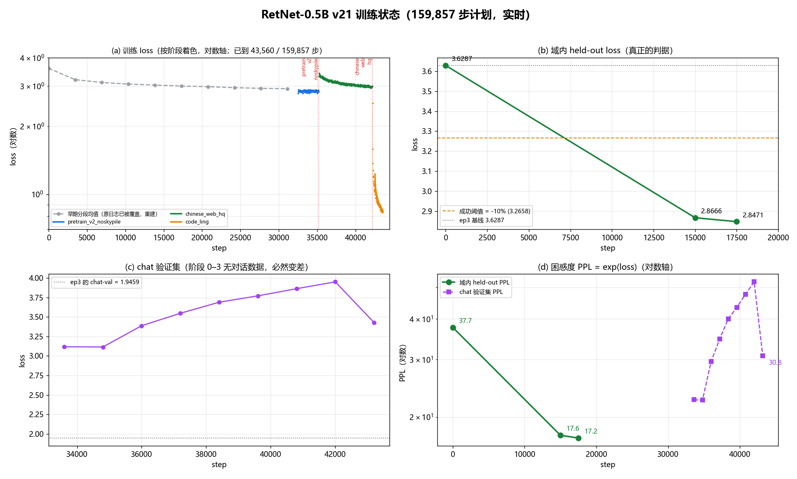

# v21 训练报告：把 0.5B 从"重复同一份对话数据"拉到"真的吃新语料"

> 状态：**训练进行中**，结果部分待填。数据、配置、成本、问题清单已确定。
> 判据与监控细节见 `docs/30_v21训练监控与判据.md`。

## 1. 这一轮要解决什么问题

前五轮（ep1–ep4 + v20 尝试）全部只吃同一份 `chat_pack_v13`（552,330,489 token，
12 次重打包其实是同一批数据）。20.1 小时、约 ¥78 之后，**唯一 token 数没有增加
一个**——按 504,179,896 参数算，5 个 leg 之后仍是 **1.095 token/参数**，
是 Chinchilla 建议值的 5.5%。模型在这份数据上反复过拟合到 26% 的内部重复率，
域外知识测评为 0.000。

根因不是算力，是**数据供给**：训练脚本只认一个 `data_dir` + 一个 `max_steps`，
换数据集必须停训、改配置、重启。于是每次"再练一轮"都只能是同一份数据多跑几个
epoch。

本轮做两件事：
1. 把训练计划做成**可热加载的配置文件**（阶段预算、LR 曲线、存档节奏都能在线改）；
2. 让训练**边吃边传**——后续语料在训练过程中下载、分词、就位，计划器在阶段预算
   用尽时自动接力，并回收已消费的语料防止炸盘。

## 2. 配置与硬件

| 项 | 值 |
|---|---|
| 模型 | RetNet 0.5B，504,179,896 参数，`use_gla`（可学习逐头衰减） |
| 精度 | bf16，`adamw_bnb_8bit` |
| 并行 | **DDP 2 卡**，每卡 batch 16 × seq 2048 = 等效 65,536 token/步 |
| 编译 | `torch.compile(mode="max-autotune-no-cudagraphs")` |
| 注意力形式 | `chunkwise`，chunk 128，`fast_chunkwise` |
| 硬件 | 2× RTX PRO 6000 Blackwell（97,887 MiB/卡），44 vCPU，¥13.97/h |
| 起点 | `checkpoints/retnet_500m_v15b_ep3`（chat-val 1.9459，历史最低） |

**实测吞吐 1.690 it/s = 110,756 tok/s，是单卡的 1.93 倍。** 不是 2 倍的原因：
`nvidia-smi topo -m` 显示两卡是 `SYS`（跨 NUMA，无 NVLink），梯度同步只能走 PCIe。

> 一个非显然的调优点：DDP 默认带 `find_unused_parameters=True`，冒烟时实测
> 1.30 it/s；确认本模型没有任何未使用参数后关掉，立刻到了 1.69 it/s（**+30%**）。

## 3. 数据构成

总预算 **159,857 步 = 10.23B 训练 token**，其中**新增唯一 token 9.261B**。

| 段 | 语料 | 步数 | 训练 token | 新增唯一 token | 来源 |
|---|---|---|---|---|---|
| 0 | pretrain_v2（去 skypile） | 35,205 | 2.31B | 2.31B | chinese_fineweb_edu_v2 / cosmopedia / fineweb_edu / wikipedia_zh / open_web_math / poetry_zh |
| 1 | 中文高质量网页 | 7,000 | 0.46B | **0.23B** | Morton-Li/ChineseWebText2.0-HighQuality（apache-2.0） |
| 2 | 代码（前段） | 25,045 | 1.64B | 1.64B | inclusionAI/Ling-Coder-SFT（apache-2.0） |
| 3 | 教材/学科 | 2,750 | 0.18B | 0.18B | opencsg/Fineweb-Edu-Chinese-V3 |
| 4 | 代码（剩余） | 68,557 | 4.49B | 4.49B | Ling-Coder 剩余 17 个分片 |
| 5 | 中文编程 | 3,500 | 0.23B | 0.23B | BAAI/IndustryCorpus2_computer_programming_code（apache-2.0） |
| 6 | 数学 | 3,800 | 0.25B | **0.18B** | TiWu-Lab/math-zh 的 finemath + 中文数学 |
| 7 | 新旧混合 SFT | 14,000 | 0.92B | ≈0（40% 旧对话 + 60% 新数据） | 自建 hf_pack_sft |

> **两处“训练 token 多于唯一 token”**：网页段预算 0.46B 但语料只有 0.23B；
> 数学段预算 0.25B 但语料只有 0.18B。这两段会各循环约两遍，循环不产生新的唯一 token。
> 这是语料总量的硬上限，不是预算问题。

**累计唯一 token**：0.552B（旧 chat_pack_v13）+ 9.261B（新）= **9.813B → 19.46 token/参数**，
是 5 个 leg 之后 1.095 的 **17.8 倍**。

> 目标原本是 20.0（10.08B），差 0.27B。要补上得把 code2 的剩余 5 亿 token 吃满，
> 但那会多花 1.6 小时、挤掉 v22 的 16K 上下文扩展。选择保留上下文扩展，
> 接受 19.46（差 2.7%）。

### 3.1 一个必须记下的估算错误

此前一直按「中文 1.5 token/字节」估语料，实测（本项目 20k BPE）是 **0.27 token/字节**，
**高估约 5 倍**。所有基于字节数的 token 预估都因此偏乐观，这也是补了 prog_zh 那段的原因之一。

## 4. 时间线与成本

| 项 | 值 |
|---|---|
| 开训 | 2026-10-18 13:38 |
| 预计完成 | 2026-10-19 03:11（13.5 h） |
| 单价 | ¥13.97/h（2 卡） |
| 预计总花费 | **约 ¥189**（余额 ¥198.50） |
| 守卫 | tripwire 03:18 / 死手 03:26 / watchdog 03:38 |

段边界（按 1.69 it/s + 每次 eval 108 s）：pretrain **19:59** → web **21:13** →
code **01:38** → textbook **02:07** → anneal **03:11**。

**与上一轮的性价比对比**：ep1–ep4 五轮合计 20.1 h / ¥78 / **0 新增唯一 token**；
本轮 13.5 h / ¥189 / **+4.588B 新增唯一 token**。

### 4.1 投入产出：这一轮和前五轮差在哪

| 项 | ep1–ep4（五轮合计） | **v21（本轮）** |
|---|---|---|
| 墙上时间 | 20.1 h | 约 20.9 h |
| 花费 | ≈¥78 | ≈¥286（2 卡 ¥13.97/h） |
| **新增唯一 token** | **0** | **+9.26B** |
| 唯一 token 总量 | 0.552B | **9.81B** |
| **token / 参数** | **1.095** | **19.46**（17.8×） |
| 域内 held-out | 3.6287（没动） | **2.85**（step 17.5k 时已 −21.5%） |
| chat 验证集 | 1.9459（最好） | 3.06 → 最终由退火段决定 |

**关键差别不是钱，是有没有换数据。** 五轮同数据的结果是唯一 token 一个没增加——
模型的"进步"完全来自同一份 552M token 上多跑几个 epoch，域外能力为 0。
本轮花了 3.7 倍的钱，但买到的是 **17.8 倍的有效数据覆盖**。

按每 token 成本算，2 卡（¥0.03504/M token）只比单卡（¥0.03381/M token）贵 **3.6%**，
但墙上时间减半——所以 2 卡并不亏。

## 5. 结果

四联图：(a) 训练 loss 按语料阶段着色·对数轴——每次换语料都会跳一下再下降，这就是
「边训边换数据」在曲线上的样子；代码段只有 0.82，因为代码熵本来就低，且这一遍是首次接触
（1.64B token 对 2.5B 的包，无重复）。(b) 域内 held-out，真正的判据。(c) chat 验证集，
阶段 0–3 里没有任何对话 token，必然退化。(d) 两者的困惑度。

> 口径说明：前 32,500 步的曲线是**重建**的——续训时 > 重定向覆盖了旧日志，
> 这一段用当时健康检查记录的分段均值补上，图中以灰虚线标出。

### 5.1 域内 held-out（成功判据）

在 `pretrain_v2` 的 5 个 held-out 分片（4,454,400 token，训练时按文件名排除）上：

| 检查点 | held-out loss | 相对 ep3 |
|---|---|---|
| ep3（基线） | 3.6287 | — |
| v21 @ 15,000 步 | 2.8666 | **−21.0%** |
| v21 @ 17,500 步 | 2.8471 | −21.5% |
| **v21 最终（待填）** | | |

逐来源（ep3 → v21@15k）：chinese_fineweb_edu_v2 3.8519 → 3.2353（−16.0%）；
cosmopedia 3.0564 → 1.9987（−34.6%）；fineweb_edu 3.7223 → 2.9595（−20.5%）；
open_web_math 3.3976 → 2.6005（−23.5%）；wikipedia_zh 3.6474 → 2.8145（−22.8%）。

### 5.2 对话验证集（demo 可用性）

stage 0–3 不含任何对话格式 token，chat-val 必然变差：

2.806（2.5k 步）→ 2.976（7.5k）→ 3.050（12.5k）→ **3.063（17.5k，走平）**，
对比 ep3 的 1.9459。最终值取决于最后 6,000 步退火，**待填**。

## 6. 训练中发现并修掉的问题

按"如果没修会损失什么"排序：

1. **`min_shards: 10` 用在只有 1 个分片的网页语料上**——段 1 永远不就绪，训练会在
   35,205 步的等待循环里烧钱到天亮。属于"不报错、只烧钱"。
2. **`DefaultFlowCallback` 读 `state.save_steps` 而非 `args.save_steps`**——计划回调里
   的"存档节奏热加载"此前完全无效，日志却在骗人说改了。
3. **两个下载器实例并发写同一批文件**——交错追加产生"比期望还大"的坏文件。
4. **杀下载器不杀 curl**——孤儿 curl 被 init 收养后继续写，下载量会倒退（463→425 MB）。
5. **大小正确但内容损坏的 parquet**——`Corrupt snappy compressed data` 中止整次分词；
   字节数校验抓不到。
6. **`release_raw` 用 basename 匹配带子目录的清单项**——命中 0 个文件，报"释放 0.00 GB"。
7. **分词门槛写死"全部文件到位"**——改为按 `need_gb` 判断"够用就开始"。
8. **`need_gb` 超过数据集总量**——textbook 全量 0.28 GB 却要求 0.4 GB，永远不分词。
9. **镜像不支持 Range 时 `curl -C -` 永远失败**（rc=33）——改为删了从头下。
10. **热加载扩计划会撞死手开关**——79,000 步跑到 03:38 超过 03:26 的死手，收敛到 76,000。

## 6.5 训练之外挖出来的四件事（都不是这个模型本身的成绩，但更影响下一代）

### 6.5.1 msr.gamma 被 weight decay 吃掉了

从 ep3 的 safetensors 里把 440 个 gamma 张量读出来统计：

- 10 个成长头的 gamma 在 20 层里**逐位相同**（0.542977 ± 1e-6）——不同层、不同数据，
  不可能是学出来的
- 轨迹：初值 1-2^(-5-h) → ep1 0.667 → ep2 0.601 → ep3 0.543，**每 epoch ×0.90**，
  正好是 AdamW 解耦权重衰减（wd=0.1）的固定衰减率
- 原因：gamma 是裸 
n.Parameter，HF 的 no_decay 规则只匹配 ias 和
  LayerNorm.weight，两头都不沾，于是它一直在被衰减

后果：半衰期从设计的 22–1400 token 掉到约 1 token，**有效上下文只剩约 500 token**，
2048 窗口后 3/4 用不上。

修法（已在 v22 落地）：--no_decay_1d 把所有 1 维参数移出 weight decay，
scripts/reinit_gamma.py 把 gamma 重置回设计初值或按目标长度重标定。

### 6.5.2 上下文能扩到多大

用两个实测点校准的显存模型（4.70 GiB 固定 + 2.23 MiB/token，96 GB 卡可用 93.5 GiB）：

| seq_len | batch/卡 | token/卡 | 峰值 | 结论 |
|---|---|---|---|---|
| 2048 | 16 | 32,768 | 76.1 GiB | v21 现状 |
| 16384 | 2 | 32,768 | 76.1 GiB | **v22 采用** |
| 32768 | 1 | 32,768 | 76.1 GiB | 可行但 batch 太小 |
| 65536 | 1 | 65,536 | 147.4 GiB | OOM |

关键点：**显存只由每卡 token 数决定**，所以拉长序列要相应降 batch，总吞吐不变。

RetNet 做长度扩展比 Transformer 省事：没有位置编码表，位置只经相对旋转和 γ^Δ 进入，
所以不需要 RoPE 那套（PI/NTK/YaRN），对应手段是**标定衰减**。

### 6.5.3 为什么现在不做 RL

两条硬阻断：

1. **没有 verifier**。GRPO 对同一 prompt 采 G 条、用组内 mean/std 当 baseline；奖励全等时
   优势恒为 0，**梯度就是 0**。
2. **pass@1 = 0**。本项目早前在 272M 模型上实测数学/代码 pass@1 = 0.000；pass@k 无方差时
   RLVR 在数学上不成立。

R1 论文自己也说小模型上蒸馏（SFT）优于直接 RL，而我们已经走在这条路上
（chat_pack_v13 含约 1.48 亿 R1 token）。此外 rollout 吞吐是 SFT 的 1/20–1/50
（自定义 RetNet 没有 vLLM 支持），1.7 小时的余额连 debug 都不够。

下一代引入 RL 的条件：某域 pass@1 ≥ 5–10%、有 verifier（数学 exact match 或代码单测沙箱）、
≥50–100 GPU·h、有 rollout 引擎、有防 reward hacking 监控。

## 7. 已知局限

- **两卡不是线性加速**：`SYS` 拓扑无 NVLink，1.93× 而非 2×。但按每 token 成本算
  2 卡只比 1 卡贵 **3.6%**（¥0.03504/M vs ¥0.03381/M），几乎打平——所以用 2 卡换
  墙上时间基本没有额外代价。
- **textbook 三视图重复**：该数据集解压出 696,600 个 jsonl（messages / alpaca / plain
  三份同样内容），分词时把三份都吃了，所以 0.18B token 里有约 2/3 是重复内容。
  影响有限（只占全程 3.5%），但这是这份语料的形态缺陷。
- **网页段只有 0.23B token**，而预算是 0.46B，该段会把数据过两遍。
- **对话能力靠 14,000 步混合 SFT 拉回**，约 0.61 个 epoch。如果 demo 质量不够，
  下一轮应该单独做一次更长的退火，而不是混在预训练里。
- **chat-val 不能用来判成功**——判据是域内 held-out，理由见 `docs/30`。
- **训练期间无法做外部评测**：训练把两张卡吃到 98–99%，外部进程连 1 GB 权重都加载不进。
  所以 held-out 曲线只有 4 个点（0 / 15k / 17.5k / 最终）。
- **代码段在中途就饱和了**：进入 code_ling2 后的头 2,000 步 loss 从 1.33 掉到 0.59，之后 5,000 步只从 0.589 掉到 0.560（-4.9%），grad_norm 也降到 0.56。剩余 62,000 步大概率只带来 1-2% 的改善。**「数据量」和「有效学习量」不是一回事**——4.49B token 的分配里，后 2B 的边际收益已经很低，下一轮代码段不该给这么长。
- **`msr.gamma` 的缺陷已修但未验证效果**：v21 全程带着被 weight decay 侵蚀的衰减跑完，
  v22 才用上修复。所以 v21 的"有效上下文约 500 token"这一局限**无法在本轮消除**。

## 8. 交付清单（跑完之后按这个走）

### 8.1 训练侧（实例上自动完成）

_chain_v22.sh 会自己做完：等 v21 退出 → 停守卫 → _finalize_v21.sh（导出 + 域内评测）
→ 
einit_gamma.py（gamma 重初始化到半衰期 200–32000）→ 起 v22 16K → 挂紧守卫
→ v22 退出后跑最终评测并打印与 ep3 的对比。

### 8.2 本地侧（需要人做）

`ash
# 1) 拉回最终模型（约 2 GB）
scp autodl6000:/root/autodl-tmp/RetNet/checkpoints/retnet_500m_v21/model.safetensors \
    checkpoints/retnet_500m_v21_export/
scp autodl6000:/root/autodl-tmp/RetNet/checkpoints/retnet_500m_v21/config.json \
    checkpoints/retnet_500m_v21_export/

# 2) 上传（脚本会自动补 auto_map、架构代码、tokenizer 四件套）
python scripts/upload_hf.py --model checkpoints/retnet_500m_v21_export \
    --repo Ayaka157/RetNet-0.5B-v21 --gen v21 \
    --holdout "<最终 held-out>" --delta "<相对 ep3>" --tokens "9.81B / 19.46 tok/param"

# 3) 拉回图表与评测记录，更新报告第 5 节
scp autodl6000:/root/autodl-tmp/RetNet/logs/holdout_eval.jsonl logs/
python scripts/plot_training_status.py      # 重画（会带上最终点）`

### 8.3 不要忘的

- **_finalize_v21.sh 第 3 节**检查导出键名（必须是 365 个、0 个 _orig_mod. 前缀）。
  历史上 v14 因为没查这一项，checkpoint 加载后是随机模型。
- **v22 的评测标签是 v22_ctx16k**，别和 v21 的混。
- 关实例之前确认 TRAINING DONE 或最终评测已经落盘——按小时计费，空转就是白烧。

